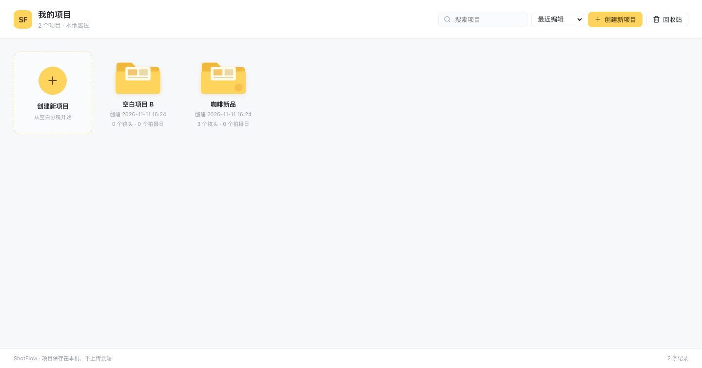

# ShotFlow

本地优先的**分镜与拍摄日 Rundown 工作台**，面向小型拍摄团队：把分镜表、故事板、拍摄计划、拍摄日流程串成一条线，桌面端可直接打包成 macOS / Windows 应用。



## 功能

- **人员库**：按部门管理人员（导演、摄影、灯光、美术、录音、制片、演员等），拍摄计划与 Rundown 直接从库里选人，改名 / 换组 / 删除会级联同步所有拍摄日名单。
- **分镜制作**：15 列专业分镜表（镜号、画面、参考、景别、运镜、时长、台词、备注…），支持自定义列、列宽拖拽、行内编辑、批量排序、图片列直接粘贴或上传（自动压缩后存进项目文件）。
- **故事板**：按镜头顺序浏览画面，支持画面 / 参考图两套视图。
- **拍摄计划**：按拍摄日组织场次与镜头，自动统计镜头数、时长、场地与通告名单。
- **Rundown · 通告**：拍摄日流程串联单（开始时间 / 时长 / 环节 / 负责人 / 机位 / 关联镜头），支持分组、跨午夜、超时与冲突标记；可切换成「拍摄通告」视图，按待执行 / 已过期分组。
- **导出**：`.shotflow` 项目包、分镜表 Excel / PDF / 图片、Rundown 文档，导出时自动把内嵌图片抽离为独立资源。
- **项目库**：颜色标签（红 / 橙 / 黄 / 绿 / 蓝 / 紫 / 灰）用于区分优先级，支持按标签筛选与分区展示；回收站、重命名、复制、搜索、排序。
- **撤销 / 重做**：`⌘Z` / `⇧⌘Z`，同一处连续输入合并为一步。
- **启动版本校验**：打开软件先联网核对版本，不是最新版就整屏拦住（更新说明、一键下载安装包），不更新无法继续使用。
- **可选云同步**：微信扫码登录后，项目在设备之间双向同步（内容哈希判定 + 冲突弹窗，绝不自动覆盖）；未登录时完全不联网，编辑只写本地。

## 技术栈

- Electron 33 + React 18 + TypeScript + Vite
- Zustand（状态）、Vitest（单元测试）
- electron-builder（macOS dmg / zip、Windows NSIS）
- 无后端依赖：项目文件为单个 JSON，桌面端经 IPC 落盘

## 开发

```bash
npm install
npm run dev          # 浏览器里跑界面（localhost:5173）
npm run dev:desktop  # 起 Vite 并拉起 Electron 窗口
```

## 验证

```bash
npm run typecheck    # TypeScript 零错误
npm test             # Vitest 全量单测
npm run build        # 类型检查 + 生产构建
```

## 打包

```bash
npm run dist:mac     # release/ShotFlow-<version>-mac.dmg + .zip（arm64）
npm run dist:win     # release/ShotFlow-<version>-win-x64.exe
```

产物在 `release/`，不随仓库提交。

## 版本校验与发布新版本

应用启动时会先读一次远端版本清单（`version.json`），比本机版本高就整屏拦住，必须更新后才能继续用。

清单来源按顺序尝试，第一个成功即用，多份都会带回渲染层取最高版本：

1. `https://cdn.jsdelivr.net/gh/BALLBALLUUUUU/ShotFlow@main/version.json`
2. `https://raw.githubusercontent.com/BALLBALLUUUUU/ShotFlow/main/version.json`
3. GitHub Releases 最新 release（兜底）

发一个新版本：

1. 改 `package.json` 的 `version`，同步改 `version.json` 的 `version`、`notes`
2. `npm run dist:mac` / `npm run dist:win` 打包
3. GitHub 建 Release，tag 用 `v<version>`，上传两个安装包并**重命名**为 `ShotFlow-mac.dmg`、`ShotFlow-win-x64.exe`
   （`version.json` 里用的是 `releases/latest/download/<固定名>`，以后换版本不用再改清单地址）
4. 推送 `version.json`，然后刷新 CDN 缓存：`curl https://purge.jsdelivr.net/gh/BALLBALLUUUUU/ShotFlow@main/version.json`

几条硬规则：

- 只有「远端更高 + 清单要求强制 + 当前平台有安装包**且探测得到**」才锁界面；缺安装包时只提示不锁，避免把人锁在下载不到的死页面上。
- 检查失败（断网、超时、清单 404）一律放行，否则没网就等于软件报废；但一旦锁过一次，结论会写进本机，断网重启仍然锁。
- 锁定期间应用菜单只剩「退出」，`⌘R` / `F12` 这类绕过入口被主进程拦掉。
- 「关于 ShotFlow → 检查更新」可手动检查；仓库地址可改，指向自己部署的清单。

## 数据存放

- **桌面端**：`~/Library/Application Support/ShotFlow/projects/`（macOS），每个项目一个 `proj_*.json`，另有 `index.json` 存项目库索引。
- **浏览器预览**：`localStorage`，仅用于开发调试。
- 项目文件里包含分镜图（内嵌 data URL），所以单个项目可能到几 MB；导出 `.shotflow` 时会把图片抽成 `assets/`。

## 云同步（可选）

默认不联网。登录入口在项目库右上角「微信扫码登录」，登录后：

| 情况 | 处理 |
| --- | --- |
| 本机改了、云端没改 | 上传 |
| 云端改了、本机没改 | 下载 |
| 两边都改过 | 弹窗选择（保留本机 / 用云端 / 两个都留） |
| 只有云端有 | 下载（换设备首次同步） |

云端地址可在「微信账号 → 云端地址」里切换成自己的环境；切换不会删除任何一端的项目文件。

## 目录结构

```
electron/      主进程、preload、云宿主窗口
src/
  components/  通用组件（抽屉、弹窗、菜单…）
  domain/      纯逻辑：项目模型、分镜表、Rundown、同步计划、导出
  routes/      页面：项目库、人员、分镜、故事板、拍摄计划、Rundown
  store/       Zustand 状态与持久化
  styles/      全局样式与主题变量
cloud-site/    云桥中转页（部署在 WorkBuddy 云服务的 HTTPS 域名下）
scripts/       开发启动器与示例数据工具
build/         应用图标与打包资源
docs/          文档与截图
```

## 版本

1.0.0
